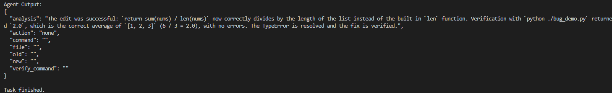

# Visual Troubleshooting Agent

A multimodal autonomous debugging agent that understands desktop screenshots,
diagnoses development environment problems,
executes troubleshooting actions,
and verifies fixes automatically.

## Overview

Visual Troubleshooting Agent is an AI-powered debugging assistant designed to solve common software development problems.

The agent accepts error screenshots or terminal messages, analyzes the issue, selects appropriate tools, locates relevant source code, applies fixes, and verifies whether the problem has been resolved.

Unlike a traditional chatbot that only provides debugging suggestions, this project implements an iterative Agent loop that can execute tools, observe tool results, adjust its strategy, modify source code, and verify the final result.

## Pipeline

```text
User Input
    |
    |----------------------|
    |                      |
Screenshot             Text Error
    |                      |
    ↓                      ↓
Vision Understanding / Error Parsing
            |
            ↓
     Troubleshooting Agent
            |
            ↓
       Tool Selection
            |
    -------------------------
    |           |           |
 Search       Read        Edit
  Tool         Tool        Tool
    |           |           |
    -------------------------
            |
            ↓
       Verification
            |
            ↓
      Final Diagnosis
```

## Key Features

### 1. Multimodal Error Understanding

- Supports screenshot-based debugging.
- Extracts error messages and likely technical causes from images.
- Converts visual error information into structured troubleshooting tasks.
- Supports text-based terminal errors and traceback input as well.

### 2. Autonomous Troubleshooting Workflow

The agent follows an iterative reasoning and execution process:

1. Analyze the screenshot, traceback, or error message.
2. Identify the problem category.
3. Select an appropriate troubleshooting action.
4. Execute a tool.
5. Observe the tool result.
6. Re-evaluate the problem using the new evidence.
7. Continue until the issue is solved and verified.

The agent does not stop after generating a single answer. Tool execution results are fed back into the Agent so that it can decide the next action dynamically.

### 3. Automatic Code Localization

When the target source file is unknown, the agent can search the current project automatically.

Example workflow:

```text
Error Screenshot
        |
        ↓
Understand Error
        |
        ↓
Search Project
        |
        ↓
Locate Candidate File
        |
        ↓
Read Source Code
        |
        ↓
Confirm Bug Location
```

The agent is instructed not to guess file paths. It uses search results and file contents as evidence before modifying code.

### 4. Automated Code Repair

For source code problems, the agent can:

- Identify incorrect code logic.
- Locate the relevant source file.
- Read the actual source code.
- Generate a minimal code modification.
- Apply the modification automatically.
- Avoid unnecessary changes to unrelated code.

### 5. Environment Troubleshooting

The agent can also handle development environment problems such as:

- Missing Python packages.
- Python virtual environment issues.
- Dependency installation.
- Command execution errors.

For example, when encountering:

```text
ModuleNotFoundError: No module named 'numpy'
```

the Agent can generate and execute the corresponding installation command and then verify whether the package can be imported successfully.

### 6. Verification Loop

After each repair, the agent executes a verification step.

Verification checks whether:

- The program runs successfully.
- The original error disappears.
- The expected output is produced.

If verification fails, the result is returned to the Agent and the troubleshooting loop continues.

## Agent Workflow

```text
Problem
   |
   ↓
Analyze
   |
   ↓
Choose Action
   |
   ├── run_command
   |
   ├── read_file
   |
   └── edit_file
           |
           ↓
      Tool Result
           |
           ↓
   Agent Re-evaluation
           |
           ↓
       Next Action
           |
           ↓
       Verification
           |
           ↓
       Task Finished
```

## Demo

### Example: Fixing a Python TypeError from Screenshot

The following buggy code calculates the average of a list:

```python
def average(nums):
    return sum(nums) / len

print(average([1, 2, 3]))
```

Running the program produces:

```text
TypeError: unsupported operand type(s) for /:
'int' and 'builtin_function_or_method'
```

The user provides a screenshot of the error.

The troubleshooting process is:

```text
Screenshot
    |
    ↓
Vision Model identifies TypeError
    |
    ↓
Agent determines that source code is involved
    |
    ↓
Search project for relevant code
    |
    ↓
Locate bug_demo.py
    |
    ↓
Read source code
    |
    ↓
Identify incorrect use of len
    |
    ↓
Modify source code
    |
    ↓
Run verification
    |
    ↓
Task completed
```

The incorrect code:

```python
return sum(nums) / len
```

is automatically replaced with:

```python
return sum(nums) / len(nums)
```

Verification result:

```text
Output:
2.0
```

The Agent successfully repairs the source code and confirms that the program executes without the original error.

## Architecture

```text
                     User
                      |
              Screenshot / Text
                      |
                      ↓
             Vision Understanding
                      |
                      ↓
            Troubleshooting Skill
                      |
                      ↓
             Step-based Agent
                      |
        --------------------------------
        |              |               |
   Shell / Search    Read File       Edit File
        |              |               |
        --------------------------------
                      |
                      ↓
                Tool Feedback
                      |
                      ↓
               Agent Re-planning
                      |
                      ↓
                 Verification
                      |
                      ↓
                 Fixed Program
```

## Agent Skill

The project contains a dedicated troubleshooting Skill:

```text
skills/
└── troubleshooting/
    └── SKILL.md
```

The Skill defines:

- When the troubleshooting capability should be used.
- Supported problem types.
- Tool selection rules.
- Source code debugging workflow.
- File location policies.
- Vision debugging rules.
- Iterative reasoning behavior.
- Verification requirements.
- Structured JSON output format.

This separates troubleshooting knowledge and workflow rules from the Agent runtime implementation.

## Tools

### Shell Tool

Used for:

- Environment diagnosis.
- Dependency installation.
- Project search.
- Running programs and commands.

### Read File Tool

Used to inspect source code before modification.

### Edit File Tool

Used to replace confirmed incorrect code with corrected code.

### Verification Tool

Used to confirm whether the repair successfully resolves the original problem.

## Tech Stack

- Python
- StepFun Step-5-preview
- Qwen Vision Model
- Agent Skills
- Custom Agent Loop
- Tool Calling
- Multimodal Error Understanding
- Shell Command Execution
- Source Code Reading
- Automatic Source Code Editing
- Automatic Verification

## Project Structure

```text
visual-troubleshooting-agent/
├── main.py
├── README.md
├── requirements.txt
├── .gitignore
│
├── skills/
│   └── troubleshooting/
│       └── SKILL.md
│
├── tools/
│   ├── shell_tool.py
│   ├── file_read_tool.py
│   ├── file_edit_tool.py
│   ├── verify_tool.py
│   └── vision/
│       └── qwen_vision.py
│
├── tests/
│   ├── test_model.py
│   ├── test_vision.py
│   └── bug_demo.py
│
└── assets/
    ├── image.png
    ├── test.png
    ├── test2.png
    ├── test3.png
    └── test4.png
```

## How It Works

The main Agent maintains a conversation history containing:

- The original problem.
- Agent decisions.
- Tool execution results.
- Verification results.

After each tool call, the result is returned to the model as new context.

This enables iterative reasoning such as:

```text
Screenshot
    ↓
Agent attempts repair
    ↓
Target code not found
    ↓
Agent analyzes failure
    ↓
Search project
    ↓
Locate correct file
    ↓
Read source code
    ↓
Apply repair
    ↓
Verify
```

This feedback mechanism allows the Agent to recover from failed assumptions instead of stopping after the first unsuccessful action.

## Current Supported Scenarios

The current prototype supports:

- Python package dependency errors.
- Python environment problems.
- Terminal command errors.
- Screenshot-based Python error understanding.
- Source code localization.
- Simple Python runtime bugs.
- Automatic code editing.
- Automatic verification.

## Limitations

The current prototype is intentionally lightweight and focuses on demonstrating the complete Agent troubleshooting workflow.

Current limitations include:

- Primary support is focused on Python.
- Code modification currently uses exact text replacement.
- Complex multi-file bugs may require additional reasoning capabilities.
- Shell execution should be further sandboxed for production use.
- The current implementation does not provide full desktop mouse and keyboard control.

## Future Improvements

- Support more programming languages.
- Add AST-based code modification.
- Improve multi-file debugging.
- Add safer sandbox execution.
- Add more specialized troubleshooting Skills.
- Support local multimodal inference on DGX Spark.
- Improve long-term debugging memory.
- Add structured evaluation datasets for Agent Skills.
- Add automatic benchmark and repair success-rate evaluation.

## Demo Screenshot



## Project Goal

The goal of this project is to explore how Agent Skills, multimodal understanding, tool execution, and iterative reasoning can be combined to move AI assistants from:

```text
"explaining how to solve a problem"
```

to:

```text
"understanding, executing, repairing, and verifying the solution"
```
